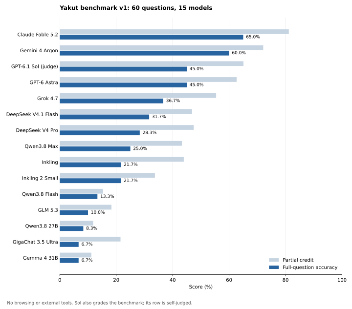

# Yakut Benchmark Leaderboard

## vals_90

Snapshot: 2026-11-15T21:49:02+00:00. Scores are percentages.

**Evaluation is in progress.** Partial scores use graded questions only;
their denominators differ and they are not final rankings. API failures
remain ungraded. Grade cells show accuracy followed by graded/total questions.

| Model Name | Company | All | Grade 1 | Grade 2 | Grade 3 | Grade 4 | Graded | Partial credit | Max reported output tokens | Status |
|---|---|---:|---:|---:|---:|---:|---:|---:|---:|---|
| GigaChat 3.5 Ultra | Sber | 6.7 | 9.1 (11/11) | 12.0 (25/25) | 3.6 (28/28) | 4.2 (24/24) | 90/90 | 14.2 | 900 | Complete |
| Qwen3.8 Max | Alibaba | 100.0 | — (0/11) | 100.0 (1/25) | — (0/28) | — (0/24) | 1/90 | 100.0 | — | API errors |
| Qwen3.8 Flash | Alibaba | 66.7 | — (0/11) | 75.0 (4/25) | 100.0 (1/28) | 0.0 (1/24) | 6/90 | 66.7 | — | Running |
| Claude Fable 5.2 | Anthropic | 65.2 | 90.9 (11/11) | 56.0 (25/25) | 74.1 (27/28) | 50.0 (24/24) | 89/90 | 78.7 | — | Running |
| Grok 4.7 | SpaceX (xAI) | 63.2 | 0.0 (1/11) | 37.5 (8/25) | 87.5 (8/28) | 100.0 (2/24) | 19/90 | 63.2 | — | Running |
| GPT-6 Astra | OpenAI | 43.5 | 45.5 (11/11) | 45.8 (24/25) | 42.3 (26/28) | 40.9 (22/24) | 85/90 | 63.6 | — | Running |
| Inkling | Thinking Machines Lab | 42.9 | 0.0 (1/11) | 100.0 (2/25) | 33.3 (3/28) | 0.0 (1/24) | 7/90 | 68.6 | — | API errors |
| GPT-6.1 Sol **(judge model)** | OpenAI | 39.3 | 45.5 (11/11) | 36.0 (25/25) | 51.9 (27/28) | 25.0 (24/24) | 89/90 | 59.4 | — | Running |
| DeepSeek V4 Pro | DeepSeek | 29.4 | 0.0 (1/11) | 12.5 (8/25) | 50.0 (4/28) | 66.7 (3/24) | 17/90 | 41.5 | — | Running |
| DeepSeek V4.1 Flash | DeepSeek | 28.6 | 0.0 (1/11) | 100.0 (1/25) | 33.3 (3/28) | 0.0 (2/24) | 7/90 | 62.5 | — | Running |
| Inkling 2 Small | Thinking Machines Lab | 23.2 | 27.3 (11/11) | 18.2 (22/25) | 30.8 (26/28) | 19.0 (21/24) | 82/90 | 36.1 | — | Running |
| GLM 5.3 | Z.ai | 15.5 | 20.0 (10/11) | 13.0 (23/25) | 23.8 (21/28) | 6.7 (15/24) | 71/90 | 24.9 | — | Running |
| Gemma 4 31B | Google | 4.5 | 0.0 (11/11) | 10.0 (20/25) | 4.8 (21/28) | 0.0 (13/24) | 66/90 | 6.0 | — | API errors |
| Qwen3.8 27B | Alibaba | 0.0 | — (0/11) | 0.0 (1/25) | 0.0 (2/28) | — (0/24) | 3/90 | 4.2 | — | Running |
| Gemini 4 Argon | Google | — | — (0/11) | — (0/25) | — (0/28) | — (0/24) | 0/90 | — | — | API errors |

Two questions have unspecified grades; they count in All, but not in grade columns.
Twelve source rows carry picture flags; solvers receive text only. All 90 supplied rows are retained.

Solvers have no browsing or tools, a 900-second answer deadline, and a requested
33,000-token output limit (Gemma: 16,384). GPT-6.1 Sol grades with a 16,000-token
budget and receives each question's `eval_instruction`; solvers do not.
Max reported output tokens includes provider-reported reasoning tokens where available.
A dash means usage has not yet been collected. Over-limit answers are retained and flagged.

[Run IDs](valkyrie/RUNS.md) · [Dataset](data/vals_90.jsonl) · [Settings](models_vals.toml)
<!-- HISTORICAL_RESULTS -->

## v1 — completed baseline

Results from 60 questions on the `clean` sheet of
[`clean_60_primary_school.xlsx`](data/sources/clean_60_primary_school.xlsx), grades 1–4.
All 15 models answered each question once. Judge: GPT 6.1 Sol, high reasoning effort.
Solvers received no browsing or external tools. The ten original v0 model settings
were kept unchanged. Accuracy requires every reference part to be correct; partial
credit is the mean share of parts correct. Confidence intervals are 95% bootstrap
intervals over questions.

| Model Name | Company | Accuracy % | 95% CI | Partial % | Requested output limit | Max reported output tokens | Over-limit answers |
|---|---|---:|---|---:|---:|---:|---:|
| Claude Fable 5.2 | Anthropic | 65.0 | 51.7–76.7 | 81.2 | 32000 | 13940 | 0 |
| Gemini 4 Argon | Google | 60.0 | 48.3–71.7 | 72.1 | 32000 | 32000 | 0 |
| GPT-6 Astra | OpenAI | 45.0 | 33.3–58.3 | 62.7 | 32000 | 11750 | 0 |
| GPT-6.1 Sol **(judge model)** | OpenAI | 45.0 | 33.3–58.3 | 65.1 | 32000 | 32000 | 0 |
| Grok 4.7 | SpaceX (xAI) | 36.7 | 25.0–48.3 | 55.4 | 32000 | 99878 | 36 |
| DeepSeek V4.1 Flash | DeepSeek | 31.7 | 20.0–43.3 | 46.9 | 32000 | 32000 | 0 |
| DeepSeek V4 Pro | DeepSeek | 28.3 | 18.3–40.0 | 47.5 | 32000 | 32000 | 0 |
| Qwen3.8 Max | Alibaba | 25.0 | 15.0–36.7 | 43.3 | 32000 | 32000 | 0 |
| Inkling | Thinking Machines Lab | 21.7 | 11.7–33.3 | 43.9 | 32000 | 32000 | 0 |
| Inkling 2 Small | Thinking Machines Lab | 21.7 | 11.7–33.3 | 33.7 | 32000 | 32000 | 0 |
| Qwen3.8 Flash | Alibaba | 13.3 | 6.7–21.7 | 15.3 | 32000 | 32000 | 0 |
| GLM 5.3 | Z.ai | 10.0 | 3.3–18.3 | 18.3 | 32000 | 32000 | 0 |
| Qwen3.8 27B | Alibaba | 8.3 | 1.7–15.0 | 11.8 | 32000 | 27411 | 0 |
| Gemma 4 31B | Google | 6.7 | 1.7–13.3 | 11.2 | 16384 | 16384 | 0 |
| GigaChat 3.5 Ultra | Sber | 6.7 | 1.7–13.3 | 21.5 | 32000 | 596 | 0 |

Exact API identifiers and generation settings are recorded in [`models.toml`](models.toml).

GPT 6.1 Sol is marked **(judge model)** because it also grades the benchmark.
Its solver answers receive the same 32,000-token requested budget as other main
solvers, while grading retains its 16,000-token budget. Its row is self-judged.

Qwen3.8 Flash is the official hosted model based on Flash-Next, not a claim to run
the exact downloadable Flash-Next weights. See the
[Qwen model card](https://huggingface.co/Qwen/Qwen3.8-Flash-Next).

Responses above their requested token limits were retained and flagged. API-reported
output usage can include reasoning tokens. The table counts main-run overages;
smoke-run overages are recorded separately in local results.

The UTF-8 dataset is [`data/ykt_primary_v1.jsonl`](data/ykt_primary_v1.jsonl).
Rebuild with `python3 build_dataset.py`; run with `bash run.sh`.
Detailed local results are in `results/v1/`. One supplied instruction/key
alignment concern remains documented in the [dataset notes](data/README.md).

### Example failure in v1

On five grade-4 word riddles, Grok took 33 minutes 55 seconds and reported 99,878
output tokens, against a requested limit of 32,000. It got two of the five parts
correct. The [UTF-8 question, reference answers, final response, and grading](examples/v1_grok_word_riddles.json)
show a concrete failure despite a long response. The time is API latency, not a
separate measurement of thinking time.

## v0 — proof of concept

Results from the original 61-question sample (grades 1–4 and 10–11), with one
answer per model and question. Judge: GPT 6.1 Sol (`gpt-6.1-sol`), high reasoning
effort. Accuracy requires every reference part to be correct; partial credit is
the mean share of parts correct. Confidence intervals are 95% bootstrap intervals
over questions. Missing, refused, and truncated answers count as wrong.

| Model Name | Company | Accuracy % | 95% CI | Partial % | Avg output tokens | Avg latency (s) |
|---|---|---:|---|---:|---:|---:|
| Claude Fable 5.2 | Anthropic | 49.2 | 36.1–62.3 | 63.0 | 772 | 9 |
| Gemini 4 Argon | Google | 45.9 | 32.8–59.0 | 61.5 | 3769 | 67 |
| GPT-6 Astra | OpenAI | 34.4 | 23.0–45.9 | 49.8 | 1516 | 43 |
| Grok 4.7 | SpaceX (xAI) | 26.2 | 14.8–37.7 | 40.7 | 27180 | 535 |
| Inkling | Thinking Machines Lab | 26.2 | 16.4–37.7 | 40.5 | 8154 | 92 |
| DeepSeek V4 Pro | DeepSeek | 23.0 | 13.1–34.4 | 35.4 | 7061 | 93 |
| DeepSeek V4.1 Flash | DeepSeek | 23.0 | 13.1–34.4 | 39.0 | 10322 | 53 |
| Inkling 2 Small | Thinking Machines Lab | 19.7 | 9.8–31.1 | 33.0 | 11282 | 60 |
| GLM 5.3 | Z.ai | 16.4 | 6.6–26.2 | 20.9 | 17072 | 129 |
| Gemma 4 31B | Google | 8.2 | 1.6–14.8 | 10.1 | 1756 | 14 |

This initial sample includes 13 picture-flagged questions, although solvers
received text only, and some prompt/answer-key alignment issues. These scores
are a proof of concept; later dataset versions should be evaluated separately.
Reasoning settings and effective token budgets differ across providers; Grok
reported output usage above its requested limit. See [benchmark documentation](USAGE.md)
for model settings and grading rules.
