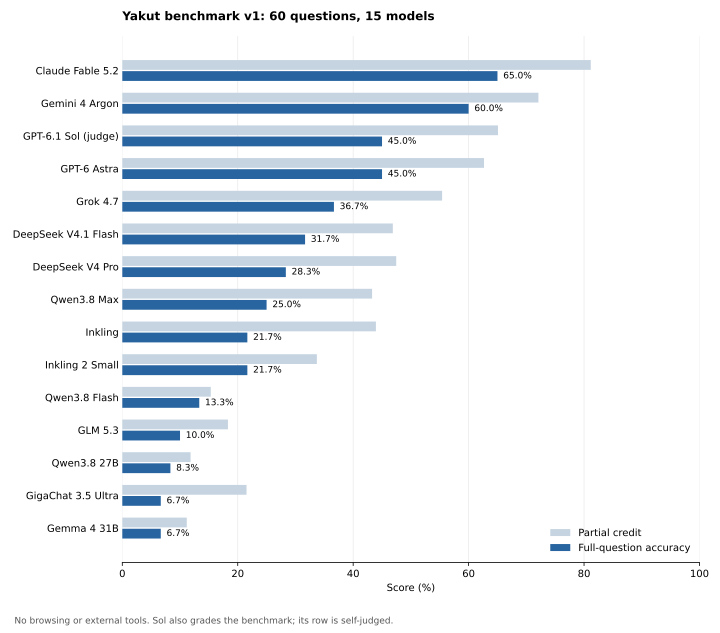

# Yakut Benchmark — v1 (60 questions)

Results from 60 questions on the `clean` sheet of
[`clean_60_primary_school.xlsx`](data/sources/clean_60_primary_school.xlsx), grades 1–4.
All 15 models answered each question once. Judge: GPT 6.1 Sol, high reasoning effort.
Solvers received no browsing or external tools. The ten original v0 model settings
were kept unchanged. Accuracy requires every reference part to be correct; partial
credit is the mean share of parts correct. Confidence intervals are 95% bootstrap
intervals over questions.

| Model Name | Company | Accuracy % | 95% CI | Partial % | Requested output limit | Max reported output tokens | Over-limit answers |
|---|---|---:|---|---:|---:|---:|---:|
| Claude Fable 5.2 | Anthropic | 65.0 | 51.7–76.7 | 81.2 | 32000 | 13940 | 0 |
| Gemini 4 Argon | Google | 60.0 | 48.3–71.7 | 72.1 | 32000 | 32000 | 0 |
| GPT-6 Astra | OpenAI | 45.0 | 33.3–58.3 | 62.7 | 32000 | 11750 | 0 |
| GPT-6.1 Sol **(judge model)** | OpenAI | 45.0 | 33.3–58.3 | 65.1 | 32000 | 32000 | 0 |
| Grok 4.7 | SpaceX (xAI) | 36.7 | 25.0–48.3 | 55.4 | 32000 | 99878 | 36 |
| DeepSeek V4.1 Flash | DeepSeek | 31.7 | 20.0–43.3 | 46.9 | 32000 | 32000 | 0 |
| DeepSeek V4 Pro | DeepSeek | 28.3 | 18.3–40.0 | 47.5 | 32000 | 32000 | 0 |
| Qwen3.8 Max | Alibaba | 25.0 | 15.0–36.7 | 43.3 | 32000 | 32000 | 0 |
| Inkling | Thinking Machines Lab | 21.7 | 11.7–33.3 | 43.9 | 32000 | 32000 | 0 |
| Inkling 2 Small | Thinking Machines Lab | 21.7 | 11.7–33.3 | 33.7 | 32000 | 32000 | 0 |
| Qwen3.8 Flash | Alibaba | 13.3 | 6.7–21.7 | 15.3 | 32000 | 32000 | 0 |
| GLM 5.3 | Z.ai | 10.0 | 3.3–18.3 | 18.3 | 32000 | 32000 | 0 |
| Qwen3.8 27B | Alibaba | 8.3 | 1.7–15.0 | 11.8 | 32000 | 27411 | 0 |
| Gemma 4 31B | Google | 6.7 | 1.7–13.3 | 11.2 | 16384 | 16384 | 0 |
| GigaChat 3.5 Ultra | Sber | 6.7 | 1.7–13.3 | 21.5 | 32000 | 596 | 0 |

Exact API identifiers and generation settings are recorded in [`models.toml`](models.toml).

GPT 6.1 Sol is marked **(judge model)** because it also grades the benchmark.
Its solver answers receive the same 32,000-token requested budget as other main
solvers, while grading retains its 16,000-token budget. Its row is self-judged.

Qwen3.8 Flash is the official hosted model based on Flash-Next, not a claim to run
the exact downloadable Flash-Next weights. See the
[Qwen model card](https://huggingface.co/Qwen/Qwen3.8-Flash-Next).

Responses above their requested token limits were retained and flagged. API-reported
output usage can include reasoning tokens. The table counts main-run overages;
smoke-run overages are recorded separately in local results.

The UTF-8 dataset is [`data/ykt_primary_v1.jsonl`](data/ykt_primary_v1.jsonl).
Rebuild with `python3 build_dataset.py`; run with `bash run.sh`.
Detailed local results are in `results/v1/`. One supplied instruction/key
alignment concern remains documented in the [dataset notes](data/README.md).

### Example failure in v1

On five grade-4 word riddles, Grok took 33 minutes 55 seconds and reported 99,878
output tokens, against a requested limit of 32,000. It got two of the five parts
correct. The [UTF-8 question, reference answers, final response, and grading](examples/v1_grok_word_riddles.json)
show a concrete failure despite a long response. The time is API latency, not a
separate measurement of thinking time.
