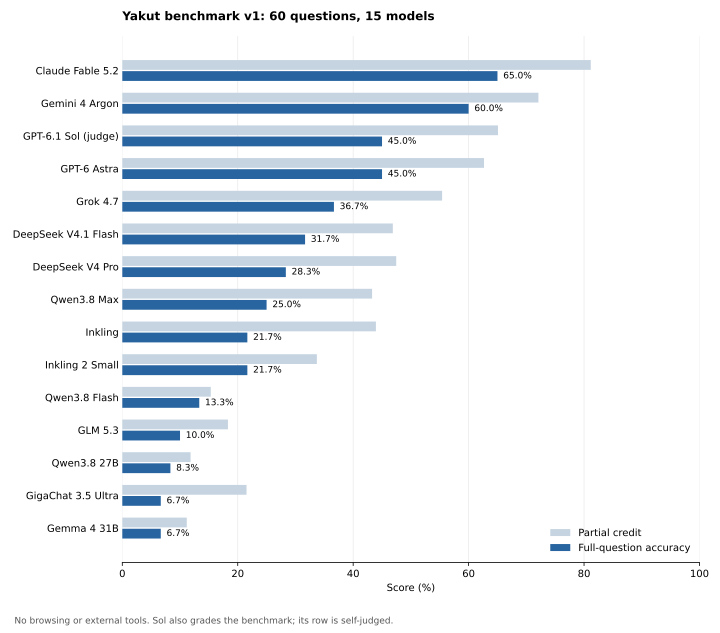

# Yakut bench

This benchmark evaluates models' capability speak and reason in Yakut. The public benchmark questions are created from text-only test questions given in the primary school textbooks (grades 1-4).

## Valkyrie submission

The [Valkyrie adapter](valkyrie/README.md) exports Harbor-format tasks and a
text-only model agent, with commands for publishing and running the dataset.
Exercise-specific `eval_instruction` text is shown only to the judge. Model
instructions, source data, and task files are versioned and hashed separately.

New evaluations use [`models_vals.toml`](models_vals.toml): a 15-minute answer
deadline and a 33,000-token requested output limit. Gemma 4 31B is limited by
its API to 16,384 output tokens. The historical results below retain their
original budgets.

## Current evaluation: vals_90

The [90-question dataset](data/vals_90.jsonl) comes from the `vals sub` sheet of
[`vals_90.xlsx`](data/sources/vals_90.xlsx). All 15 model runs have been launched
on Valkyrie and Modal; results are in progress. [Run IDs and monitoring commands](valkyrie/RUNS.md)
are available for the team.

Each solver receives the exercise instruction and material. The judge receives
the answer key and any exercise-specific `eval_instruction`; those instructions
are never shown to the solver. The five supplied grading instructions override
the generic rubric where specified, including accepted Russian spellings.

All 90 supplied questions are retained. Twelve rows still carry picture flags
from the source workbook; models receive text only. Two new items have no grade
metadata, and six missing IDs were generated deterministically. These details
are recorded in the [dataset manifest](data/vals_90.manifest.json).

The tables below remain the completed historical runs, not vals_90 results.

## v1 — completed baseline

Results from 60 questions on the `clean` sheet of
[`clean_60_primary_school.xlsx`](data/sources/clean_60_primary_school.xlsx), grades 1–4.
All 15 models answered each question once. Judge: GPT 6.1 Sol, high reasoning effort.
Solvers received no browsing or external tools. The ten original v0 model settings
were kept unchanged. Accuracy requires every reference part to be correct; partial
credit is the mean share of parts correct. Confidence intervals are 95% bootstrap
intervals over questions.

| Model Name | Company | Accuracy % | 95% CI | Partial % | Requested output limit | Max reported output tokens | Over-limit answers |
|---|---|---:|---|---:|---:|---:|---:|
| Claude Fable 5.2 | Anthropic | 65.0 | 51.7–76.7 | 81.2 | 32000 | 13940 | 0 |
| Gemini 4 Argon | Google | 60.0 | 48.3–71.7 | 72.1 | 32000 | 32000 | 0 |
| GPT-6 Astra | OpenAI | 45.0 | 33.3–58.3 | 62.7 | 32000 | 11750 | 0 |
| GPT-6.1 Sol **(judge model)** | OpenAI | 45.0 | 33.3–58.3 | 65.1 | 32000 | 32000 | 0 |
| Grok 4.7 | SpaceX (xAI) | 36.7 | 25.0–48.3 | 55.4 | 32000 | 99878 | 36 |
| DeepSeek V4.1 Flash | DeepSeek | 31.7 | 20.0–43.3 | 46.9 | 32000 | 32000 | 0 |
| DeepSeek V4 Pro | DeepSeek | 28.3 | 18.3–40.0 | 47.5 | 32000 | 32000 | 0 |
| Qwen3.8 Max | Alibaba | 25.0 | 15.0–36.7 | 43.3 | 32000 | 32000 | 0 |
| Inkling | Thinking Machines Lab | 21.7 | 11.7–33.3 | 43.9 | 32000 | 32000 | 0 |
| Inkling 2 Small | Thinking Machines Lab | 21.7 | 11.7–33.3 | 33.7 | 32000 | 32000 | 0 |
| Qwen3.8 Flash | Alibaba | 13.3 | 6.7–21.7 | 15.3 | 32000 | 32000 | 0 |
| GLM 5.3 | Z.ai | 10.0 | 3.3–18.3 | 18.3 | 32000 | 32000 | 0 |
| Qwen3.8 27B | Alibaba | 8.3 | 1.7–15.0 | 11.8 | 32000 | 27411 | 0 |
| Gemma 4 31B | Google | 6.7 | 1.7–13.3 | 11.2 | 16384 | 16384 | 0 |
| GigaChat 3.5 Ultra | Sber | 6.7 | 1.7–13.3 | 21.5 | 32000 | 596 | 0 |

Exact API identifiers and generation settings are recorded in [`models.toml`](models.toml).

GPT 6.1 Sol is marked **(judge model)** because it also grades the benchmark.
Its solver answers receive the same 32,000-token requested budget as other main
solvers, while grading retains its 16,000-token budget. Its row is self-judged.

Qwen3.8 Flash is the official hosted model based on Flash-Next, not a claim to run
the exact downloadable Flash-Next weights. See the
[Qwen model card](https://huggingface.co/Qwen/Qwen3.8-Flash-Next).

Responses above their requested token limits were retained and flagged. API-reported
output usage can include reasoning tokens. The table counts main-run overages;
smoke-run overages are recorded separately in local results.

The UTF-8 dataset is [`data/ykt_primary_v1.jsonl`](data/ykt_primary_v1.jsonl).
Rebuild with `python3 build_dataset.py`; run with `bash run.sh`.
Detailed local results are in `results/v1/`. One supplied instruction/key
alignment concern remains documented in the [dataset notes](data/README.md).

### Example failure in v1

On five grade-4 word riddles, Grok took 33 minutes 55 seconds and reported 99,878
output tokens, against a requested limit of 32,000. It got two of the five parts
correct. The [UTF-8 question, reference answers, final response, and grading](examples/v1_grok_word_riddles.json)
show a concrete failure despite a long response. The time is API latency, not a
separate measurement of thinking time.

## v0 — proof of concept

Results from the original 61-question sample (grades 1–4 and 10–11), with one
answer per model and question. Judge: GPT 6.1 Sol (`gpt-6.1-sol`), high reasoning
effort. Accuracy requires every reference part to be correct; partial credit is
the mean share of parts correct. Confidence intervals are 95% bootstrap intervals
over questions. Missing, refused, and truncated answers count as wrong.

| Model Name | Company | Accuracy % | 95% CI | Partial % | Avg output tokens | Avg latency (s) |
|---|---|---:|---|---:|---:|---:|
| Claude Fable 5.2 | Anthropic | 49.2 | 36.1–62.3 | 63.0 | 772 | 9 |
| Gemini 4 Argon | Google | 45.9 | 32.8–59.0 | 61.5 | 3769 | 67 |
| GPT-6 Astra | OpenAI | 34.4 | 23.0–45.9 | 49.8 | 1516 | 43 |
| Grok 4.7 | SpaceX (xAI) | 26.2 | 14.8–37.7 | 40.7 | 27180 | 535 |
| Inkling | Thinking Machines Lab | 26.2 | 16.4–37.7 | 40.5 | 8154 | 92 |
| DeepSeek V4 Pro | DeepSeek | 23.0 | 13.1–34.4 | 35.4 | 7061 | 93 |
| DeepSeek V4.1 Flash | DeepSeek | 23.0 | 13.1–34.4 | 39.0 | 10322 | 53 |
| Inkling 2 Small | Thinking Machines Lab | 19.7 | 9.8–31.1 | 33.0 | 11282 | 60 |
| GLM 5.3 | Z.ai | 16.4 | 6.6–26.2 | 20.9 | 17072 | 129 |
| Gemma 4 31B | Google | 8.2 | 1.6–14.8 | 10.1 | 1756 | 14 |

This initial sample includes 13 picture-flagged questions, although solvers
received text only, and some prompt/answer-key alignment issues. These scores
are a proof of concept; later dataset versions should be evaluated separately.
Reasoning settings and effective token budgets differ across providers; Grok
reported output usage above its requested limit. See [benchmark documentation](USAGE.md)
for model settings and grading rules.
